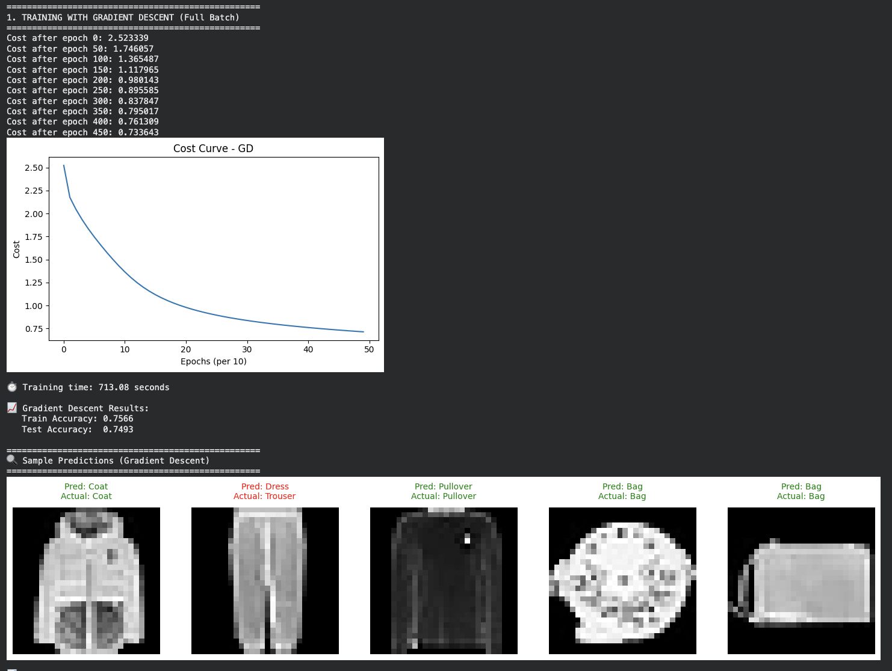
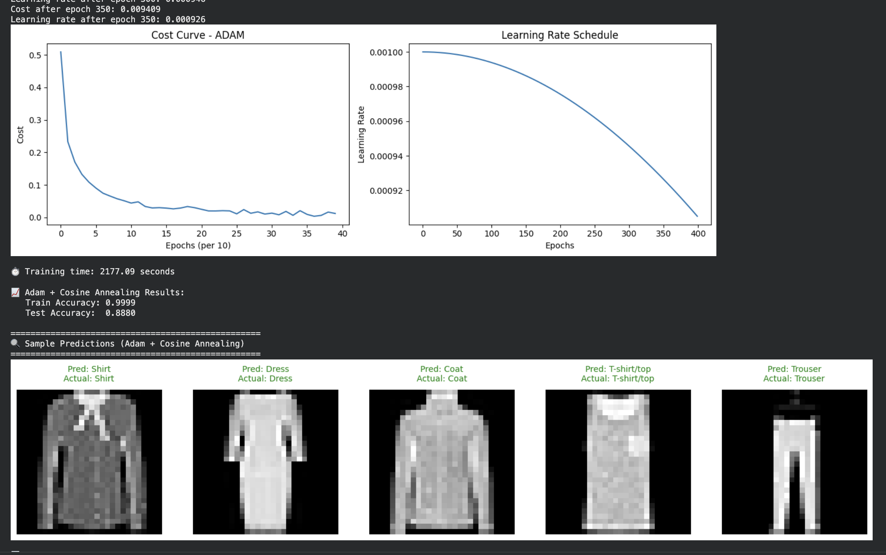
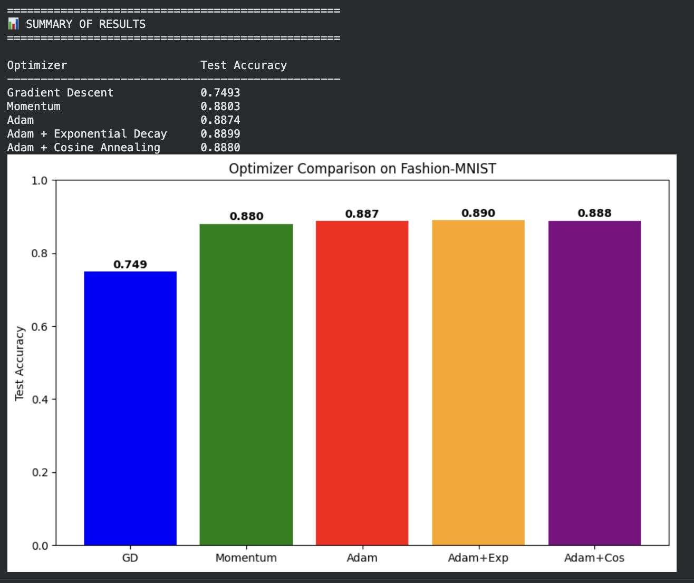
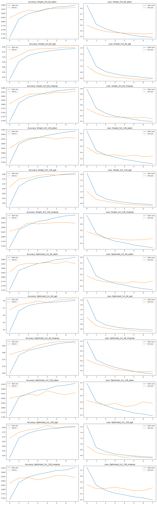
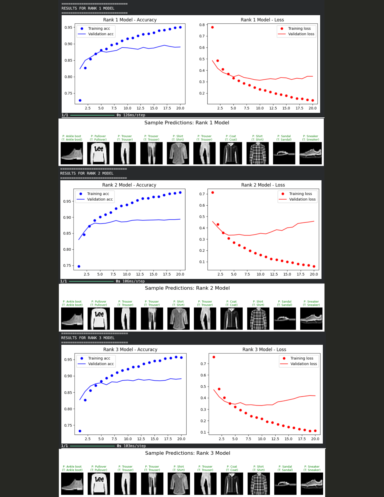

# Comparative Study of Optimization and Hyperparameter Tuning in Neural Networks and CNNs (Fashion-MNIST)

An end-to-end experimental study investigating how **model architecture**, **optimization algorithms**, **learning-rate schedules**, and **hyperparameter search strategies** impact training dynamics, convergence speed, generalization, and overfitting on the **Fashion-MNIST** dataset.

> **Author & Implementation Note:** All experimental code, training loops, hyperparameter search pipelines, and comparative analyses across Parts 1–3 were authored and executed by **José Alberto Isidoro Sánchez**.

---

## Research Question & Progression

Image classification performance depends not only on network capacity, but also on how gradients are computed, scaled, and regularized across training. Rather than jumping straight to automated tuning, this project progresses through three structured stages:

1. **Part 1 — From-Scratch Fully Connected Neural Network (NumPy):** Manual forward/backward propagation, He initialization, mini-batching, and optimization variants (Full-Batch GD, Momentum, Adam, Adam + Exponential Decay, Adam + Cosine Annealing).
2. **Part 2 — Convolutional Neural Networks with Grid Search (TensorFlow/Keras):** Comparing a standard `3x3` CNN (`Simple_3x3`) against a `1x1` bottleneck + `3x3` CNN (`Optimized_1x1`) using both manual `for`-loop logging and TensorBoard HParams.
3. **Part 3 — Automated Hyperparameter Tuning (`Keras Tuner`):** Expanding the search space to jointly tune architecture, dense units, dropout rate, optimizer, initial learning rate, LR decay schedule (`exponential` vs. `cosine`), and batch size, followed by retraining top-ranked configurations.

---

## Dataset

- **Dataset:** [Fashion-MNIST](https://www.kaggle.com/datasets/zalando-research/fashionmnist) (`70,000` grayscale `28x28` images across `10` apparel categories: `T-shirt/top`, `Trouser`, `Pullover`, `Dress`, `Coat`, `Sandal`, `Shirt`, `Sneaker`, `Bag`, `Ankle boot`).
- **Splits & Preprocessing:** 60,000 training images and 10,000 test images normalized to `[0, 1]`. Flattened to `(784, m)` with one-hot labels for the NumPy MLP, and reshaped to `(N, 28, 28, 1)` with integer labels (`SparseCategoricalCrossentropy(from_logits=True)`) for the CNNs. Faster exploratory runs also support a 20% training subset (`use_subset=True`).

---

## Stage-by-Stage Breakdown & Key Takeaways

### Part 1: Manual MLP & Optimization Regimes (`pt1_final_project_NS_team3.ipynb`)
- **Architecture:** `784 -> 128 (ReLU) -> 64 (ReLU) -> 10 (Softmax)` initialized with **He initialization** and trained with **categorical cross-entropy** (with numerical stability safeguards for softmax and log).
- **Experiments Compared:**
  - **Full-Batch Gradient Descent (`lr=0.01`, 500 epochs):** Smooth cost reduction (~`2.52` at epoch 0 down to ~`0.73` by epoch 450), reaching `0.749` test accuracy—slow convergence due to full-dataset updates.
  - **Mini-Batch GD + Momentum (`beta=0.9`, `batch_size=64`, `lr=0.01`, 400 epochs):** Reached `0.880` test accuracy with much faster loss descent.
  - **Adam (`lr=0.001`, `batch_size=64`, 400 epochs):** Reached `0.887` test accuracy with rapid early loss reduction.
  - **Adam + Exponential Decay (`0.887` / `0.890` in summary plots)** and **Adam + Cosine Annealing (`0.888`):** Maintained strong accuracy while modulating step sizes smoothly over training.
- **Takeaway:** Moving from full-batch GD to mini-batch adaptive/momentum methods dramatically accelerates convergence and improves test accuracy even on a flattened MLP that discards 2D spatial structure.

| Gradient Descent Example | Adam Optimizer & Schedule Example | Overall Optimizer Comparison |
| :---: | :---: | :---: |
|  |  |  |
---

### Part 2: CNN Architectures & Grid Search (`pt2_final_project_grid_search_team3.ipynb`)
Two convolutional families were evaluated to test spatial feature extraction and channel recombination:
- **`Simple_3x3`:** `Conv2D(32, 3x3, ReLU) -> MaxPooling2D(2x2) -> Flatten -> Dense(units, ReLU) -> Dropout(rate) -> Dense(10)`
- **`Optimized_1x1`:** `Conv2D(16, 1x1, ReLU) -> Conv2D(32, 3x3, ReLU) -> MaxPooling2D(2x2) -> Flatten -> Dense(units, ReLU) -> Dropout(rate) -> Dense(10)` (inspired by bottleneck channel mixing before spatial filtering).

Two search workflows were implemented:
1. **Manual Grid Search (`2 arch x 2 neurons [64, 128] x 3 optimizers [adam, sgd, rmsprop] = 12 runs`, `dropout=0.3`, `batch_size=64`, 8 epochs):**
   - Adaptive optimizers (`adam`, `rmsprop`) achieved higher training and validation accuracy (~`0.870–0.885` val acc; up to `0.930` train acc on `Optimized_1x1_128_adam`) compared to plain `sgd` (~`0.793–0.818` val acc in 8 epochs).
   - Inspecting loss curves revealed **overfitting signs** in higher-capacity runs (such as `Simple_3x3_128_rmsprop` and `Optimized_1x1_64_adam`), where training loss kept falling while validation loss began ticking upward.
2. **TensorBoard HParams Grid Search (`48 runs` across architecture, units `[64, 128]`, dropout `[0.3, 0.5]`, optimizers `[adam, sgd, rmsprop]`, and batch sizes `[32, 64]`, 10 epochs):**
   - Logged `accuracy`, `loss_train`, and `loss_val` to TensorBoard for interactive parallel-coordinate and scalar inspection.



---

### Part 3: Automated Search with Keras Tuner (`pt3_final_project_keras_tensorflow_team3.ipynb`)
- Expanded the search space to include **initial learning rate** (`1e-2`, `1e-3`) and **LR decay schedules** (`ExponentialDecay` vs. `CosineDecay`) alongside architecture, dense units, dropout, optimizer, and batch size using `keras_tuner.RandomSearch` (`max_trials=10`, `objective='val_accuracy'`).
- **Top Trial & Retraining Insights:**
  - In the 10-trial search, configurations pairing `Optimized_1x1` (`128` units, `dropout=0.3`, `batch_size=32`) with `rmsprop` (`lr=0.001`, `exponential` decay) reached `~0.8923` validation accuracy, while `Simple_3x3` (`64` units, `dropout=0.3`, `batch_size=64`, `adam`, `lr=0.01`, `cosine` schedule) reached `~0.8752`.
  - Retraining the top models for 20 epochs highlighted the classic **train vs. validation gap** when capacity is high (`698,314` parameters for `Optimized_1x1` with 128 dense units vs. `347,146` for `Simple_3x3` with 64 dense units): training accuracy climbed above `0.94–0.96` while validation accuracy plateaued around `~0.88–0.89`, underscoring the importance of regularization, early stopping/LR tuning, and validation monitoring rather than chasing training loss alone.



---

## Key Conclusions & Future Directions

- **Why metrics behave the way they do:** High accuracy and low training loss do not automatically guarantee strong generalization—capacity, optimizer dynamics, learning-rate decay, and batch size interact strongly, and validation loss curves are essential to spot overfitting early.
- **Automated search vs. manual control:** Automated tuning (`Keras Tuner` + `TensorBoard`) scales hyperparameter exploration cleanly, while manual/baseline implementations clarify gradient mechanics and debugging.
- **Next steps:** Evaluate pretrained backbones/fine-tuning, apply explainable AI methods (such as **Grad-CAM**) to inspect spatial attention on confusing apparel classes (e.g., *Shirt* vs. *Pullover*/*Coat*/*T-shirt*), and test generalization across external datasets.

---

## Repository Contents

- `fmnist_notebooks//pt1_fmnist_NS.ipynb` — Part 1: Manual NN & optimizer/LR schedule experiments.
- `fmnist_notebooks/pt2_fmnist_grid_search.ipynb` — Part 2: Manual loop & TensorBoard CNN grid search.
- `fmnist_notebooks/pt3_fmnist_keras_tensorflow.ipynb` — Part 3: Keras Tuner search & top-model retraining.
- `presentation/Neural_Systems_Final_Project.pdf` — Project slide deck summarizing methodology, visual diagnostics, and conclusions.


## PROJECT STRUCTURE:
```text
fashion-mnist-optimization-study/
├── README.md
├── fmnist_notebooks/
│   ├── pt1_fmnist_NS.ipynb
│   ├── pt2_fmnist_grid_search.ipynb
│   └── pt3_fmnist_keras_tensorflow.ipynb
├── presentation/
│   └── Neural_Systems_Final_Project.pdf
└── assets/
    ├── part1_gradient_opt_example.png
    ├── part1_adam_opt_example.png
    ├── part1_optimizer_comparison.png
    ├── part2_grid_search_curves.png
    ├── part2_tensorboard_hparam_grid.png
    └── part3_top3_models_comparison.png
```
